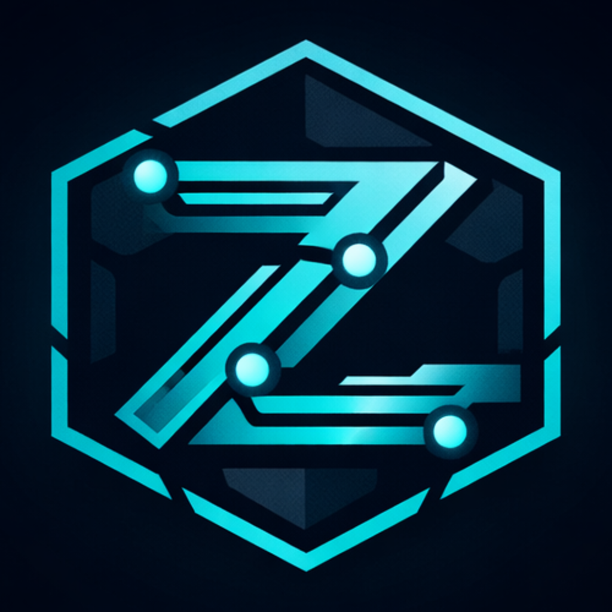
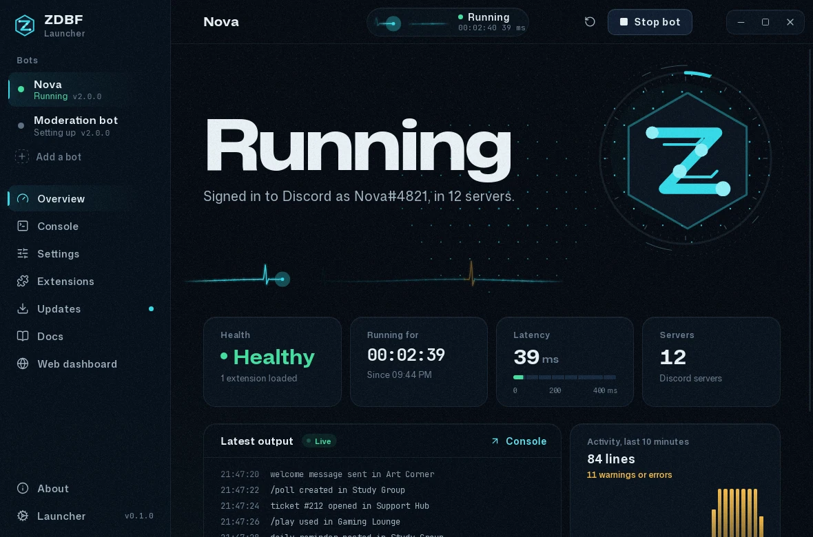
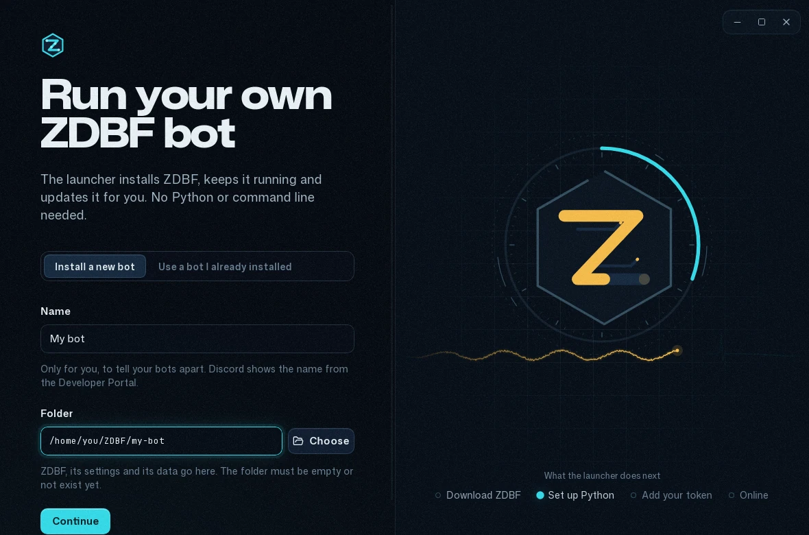
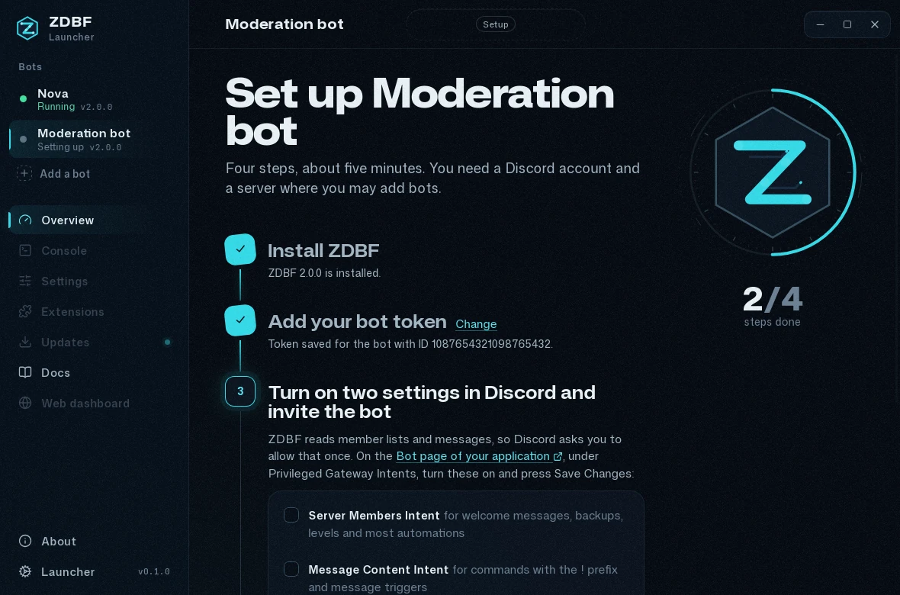
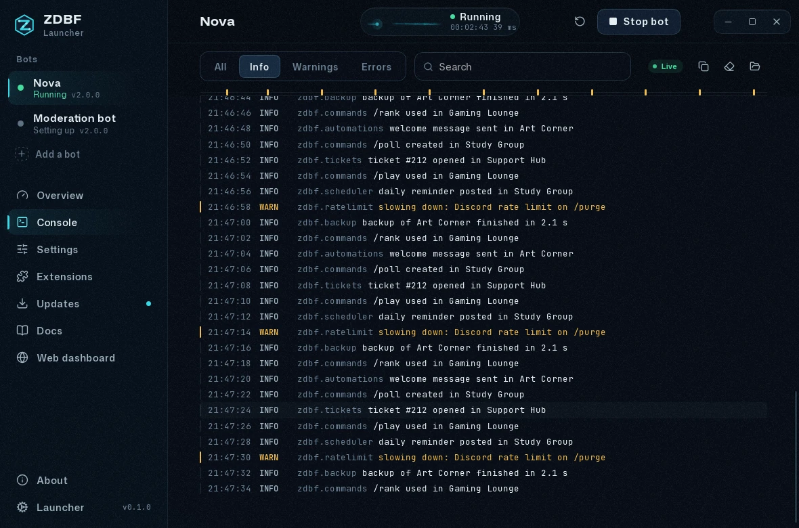
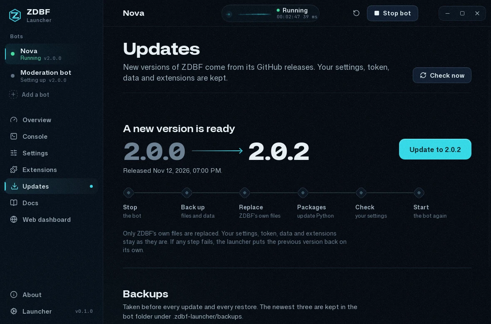
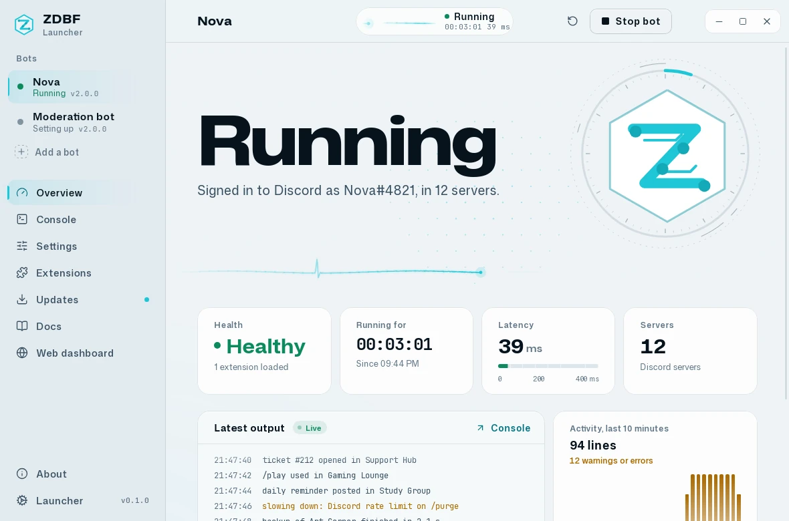
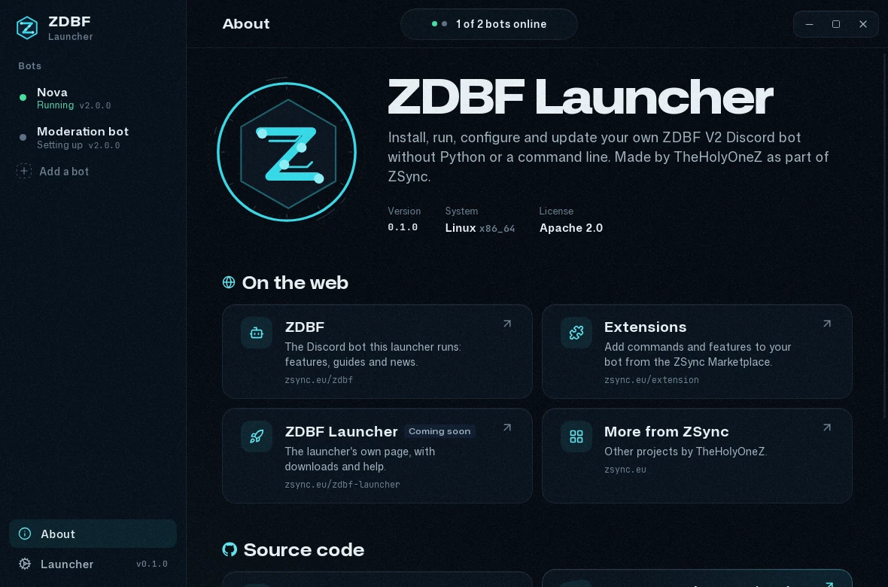

<div align="center">



# ZDBF Launcher

**Run your own [ZDBF V2](https://zsync.eu/zdbf/) Discord bot. No Python, no command line, no server.**

[](https://github.com/TheHolyOneZ/zdbf-launcher/releases/latest)
[](#download)
[](LICENSE)

[Download](#download) &nbsp;|&nbsp; [First start](#first-start) &nbsp;|&nbsp; [Questions](#questions) &nbsp;|&nbsp; [ZDBF website](https://zsync.eu/zdbf/) &nbsp;|&nbsp; [Extensions](https://zsync.eu/extension/)

<br>



</div>

<br>

ZDBF Launcher is a desktop app for people who want their own Discord bot without becoming a developer. Install it,
paste your bot token, and a few minutes later your bot is online in your server. After that the launcher keeps it
running, updates it safely, lets you change its settings in plain language, shows you what it is doing, and can set up
the ZDBF web dashboard on the same computer.

It runs [ZDBF V2](https://github.com/TheHolyOneZ/ZDBF-V2), the free, open-source Discord bot by TheHolyOneZ:
moderation, server backups, automations, a scheduler, tickets, levels and more, extendable with
[extensions](https://zsync.eu/extension/).

## What you get

- **A bot in five minutes.** The launcher downloads ZDBF and its own private copy of Python. It walks you through the
  Discord Developer Portal step by step and gives you the invite link for your server.
- **Always on, never stuck.** Start, stop and restart with one click. If the bot crashes, the launcher can start it
  again, waiting a little longer each time. It never loops on a wrong token or a broken setting; it tells you what to
  fix instead.
- **See what your bot is doing.** A live view of the bot: its health, latency, servers and uptime, a signal that moves
  with every event, and a console with filters, search and readable error details. Your token is always hidden.
- **Settings without text files.** Every option as a form with an explanation. The bot checks your changes before they
  are saved, and changes made from Discord are shown next to the setting they override.
- **Safe updates.** New ZDBF versions show up with what changed. The launcher backs up the bot first, replaces only
  ZDBF's own files and keeps your settings, token, data and extensions. If anything goes wrong, it puts the old
  version back on its own.
- **Docs built in.** The documentation for your installed version, searchable, plus the newest docs when an update is
  out.
- **Web dashboard on this computer.** One button prepares the ZDBF web dashboard and opens its setup in your browser.
- **As many bots as you like.** Each with its own folder, token and settings.
- **Stays out of your way.** Keep bots running in the system tray, start with your computer, and turn the animations
  down if your computer is older.

## Download

Get the newest version from the **[ZDBF Launcher website](https://zsync.eu/zdbf-launcher/#download)** or the **[releases page](https://github.com/TheHolyOneZ/zdbf-launcher/releases/latest)**.

| Your system | Download |
|---|---|
| Windows 10 or 11 (64-bit) | `ZDBF Launcher_x.y.z_x64-setup.exe` |
| macOS 11 or newer (Apple Silicon and Intel) | `ZDBF Launcher_x.y.z_universal.dmg` |
| Linux, any distribution (64-bit) | `ZDBF Launcher_x.y.z_amd64.AppImage` |
| Debian, Ubuntu, Linux Mint and similar | `ZDBF Launcher_x.y.z_amd64.deb` |

You also need an internet connection while the launcher installs or updates a bot, and some free disk space for Python
and the bot (a few hundred MB).

### Opening it for the first time

The launcher is free and not signed with a paid Apple or Microsoft certificate, so your system asks once whether you
trust it. That is expected.

<details>
<summary><b>Windows</b></summary>

<br>

Run the installer. If **Windows protected your PC** appears, choose **More info**, then **Run anyway**. The installer
does not need administrator rights and puts the launcher in your Start menu.

If Microsoft Edge WebView2 is missing (rare on Windows 10 and 11), the installer downloads it for you.

</details>

<details>
<summary><b>macOS</b></summary>

<br>

1. Open the `.dmg` and drag **ZDBF Launcher** into **Applications**.
2. Open it. macOS says it cannot verify the app. Press **Done**.
3. Open **System Settings → Privacy & Security**, scroll down and press **Open Anyway** next to ZDBF Launcher, then
   confirm. You only do this once.

If macOS says the app "is damaged and can't be opened", that is the same check. Open the Terminal app and run:

```bash
xattr -dr com.apple.quarantine "/Applications/ZDBF Launcher.app"
```

</details>

<details>
<summary><b>Linux</b></summary>

<br>

**AppImage:** make the file executable, then double-click it. Right-click it, choose **Properties** and allow running
it as a program, or run:

```bash
chmod +x "ZDBF Launcher_"*.AppImage
```

On Ubuntu 22.04 and newer, AppImages need `libfuse2` (`sudo apt install libfuse2`, on 24.04 `libfuse2t64`).

**.deb:** install it with `sudo apt install ./ZDBF\ Launcher_*_amd64.deb`. It then appears in your applications menu.

</details>

## First start



1. **Add a bot.** Give it a name and pick a folder, or keep the suggested one. Already have a ZDBF V2 bot? Choose
   **Use a bot I already installed** instead.
2. **Install.** The launcher downloads ZDBF and Python. The first time takes a few minutes.
3. **Bot token.** In the [Discord Developer Portal](https://discord.com/developers/applications) create an
   application, open **Bot**, press **Reset Token** and paste the token into the launcher.
4. **Two switches in Discord.** On the same page turn on **Server Members Intent** and **Message Content Intent**,
   then add the bot to your server with the invite link the launcher shows you.
5. **Start.** The launcher waits until your bot is online and tells you in plain words if something is wrong.

Then type `/help` in your server.



## A closer look

<table>
  <tr>
    <td width="50%"><br><b>Console.</b> Live output with filters and search. Errors are folded into readable details, and tokens are hidden.</td>
    <td width="50%"><br><b>Updates.</b> See what changed, then update with a backup. A failed update is rolled back on its own.</td>
  </tr>
  <tr>
    <td width="50%"><br><b>Light or dark.</b> Follows your system, or pick one under Launcher.</td>
    <td width="50%"><br><b>About.</b> Links to the ZDBF website, extensions and the source code.</td>
  </tr>
</table>

## Updates

**Your bot.** The launcher checks for new ZDBF releases every 12 hours and shows a dot next to **Updates** when one is
out. Updating stops the bot, backs it up, installs the new version, checks your settings with it and starts the bot
again. The newest three backups are kept, and you can restore any of them.

**The launcher.** It checks for a new version of itself once a day and asks before installing it. On Linux this works
for the AppImage; with the `.deb`, download the new version from the releases page.

## Where your things are

| What | Where |
|---|---|
| A bot: ZDBF, its settings (`config.toml`), token (`.env`), database and extensions | The folder you chose. By default `~/ZDBF/<name>`, on Windows `%LOCALAPPDATA%\ZDBF\<name>` |
| Backups taken before updates | `.zdbf-launcher/backups` inside the bot folder |
| The launcher's own Python, PHP, caches and settings | Linux `~/.local/share/eu.zsync.zdbf-launcher`, Windows `%APPDATA%\eu.zsync.zdbf-launcher`, macOS `~/Library/Application Support/eu.zsync.zdbf-launcher` |

Your token stays on your computer, in the bot's `.env` file. The launcher never shows it again after you save it and
never sends it anywhere except to Discord, through your bot.

## Questions

<details>
<summary><b>Does my bot stop when I close the window?</b></summary>

<br>

You choose. The first time you close the window while a bot runs, the launcher asks. With **Keep running** it moves to
the system tray and your bots stay online; open it again from the tray icon, or quit there. You can change this later
under **Launcher → Running in the background**.

</details>

<details>
<summary><b>Can my bot run while my computer is off?</b></summary>

<br>

No. The bot runs on your computer, so it is online while your computer is on and the launcher runs. Turn on **Open the
launcher when I sign in** and **Start with the launcher** for each bot to have them start by themselves. For a bot that
is online around the clock, run ZDBF on a server or a small always-on computer; the
[ZDBF docs](https://zsync.eu/zdbf/) explain how.

</details>

<details>
<summary><b>Can I run the bot without the launcher?</b></summary>

<br>

Yes. A bot folder is an ordinary ZDBF V2 installation. From inside the folder run `.venv/bin/python -m zdbf`
(Windows: `.venv\Scripts\python.exe -m zdbf`).

</details>

<details>
<summary><b>Where do I get extensions?</b></summary>

<br>

From the [ZSync Marketplace](https://zsync.eu/extension/). Install them with `/marketplace` in Discord, or put a `.py`
file into the bot's `extensions` folder. Turn them on and off under **Extensions** in the launcher.

</details>

<details>
<summary><b>Can I open the web dashboard on my phone?</b></summary>

<br>

The dashboard the launcher sets up only listens on this computer. To use it from other devices, put it on web hosting
with `/dashboard export` in Discord; the dashboard guide in **Docs** explains how.

</details>

<details>
<summary><b>The animations are too much for my computer.</b></summary>

<br>

Open **Launcher** and set **Animations** to **Reduced**. The launcher also follows your system's reduce-motion
setting.

</details>

<details>
<summary><b>The bot does not start. What now?</b></summary>

<br>

The overview says why in plain words and what to do, for example a token Discord did not accept or the two intents
that are still off. The **Console** shows the full output. If the Python environment broke, use **Repair Python** under
**Settings**; your settings and data stay. Still stuck? Open an
[issue](https://github.com/TheHolyOneZ/zdbf-launcher/issues) and include what the console shows (your token is already
hidden there).

</details>

<details>
<summary><b>How do I uninstall everything?</b></summary>

<br>

Uninstall the launcher like any other app, then delete the bot folders and the launcher data folder listed under
[Where your things are](#where-your-things-are). **Remove from the launcher** inside the app never deletes a bot
folder.

</details>

## More from ZSync

| | |
|---|---|
| **ZDBF**, the Discord bot | [zsync.eu/zdbf](https://zsync.eu/zdbf/) |
| **Extensions** for ZDBF | [zsync.eu/extension](https://zsync.eu/extension/) |
| **ZDBF Launcher** homepage | [zsync.eu/zdbf-launcher](https://zsync.eu/zdbf-launcher/) |
| **More projects** by TheHolyOneZ | [zsync.eu](https://zsync.eu/) |
| ZDBF V2 source code | [github.com/TheHolyOneZ/ZDBF-V2](https://github.com/TheHolyOneZ/ZDBF-V2) |
| ZDBF Launcher source code | [github.com/TheHolyOneZ/zdbf-launcher](https://github.com/TheHolyOneZ/zdbf-launcher) |

## License

Apache License 2.0, see [LICENSE](LICENSE) and [NOTICE](NOTICE). Third-party components and their licenses are listed
in [THIRD-PARTY-NOTICES.md](THIRD-PARTY-NOTICES.md). The names ZDBF, ZSync, Zoryx and TheHolyOneZ are not licensed as
trademarks.

<div align="center">
<br>
Made by <b>TheHolyOneZ</b> &nbsp;|&nbsp; <a href="https://zsync.eu/">zsync.eu</a>
</div>
